<p align="center">
  
</p>

<p align="center">
  <a href="https://github.com/darkandcryssis-eng/evasion-desktop/releases/latest/download/Evasion.exe"><picture><source media="(prefers-color-scheme: light)" srcset="docs/readme/download-light.svg"></picture></a>
  &nbsp;
  <a href="https://github.com/darkandcryssis-eng/evasion-desktop/releases/latest/download/Evasion-macOS.zip"><picture><source media="(prefers-color-scheme: light)" srcset="docs/readme/download-mac-light.svg"></picture></a>
</p>

<p align="center">
  <a href="#как-начать">Первый запуск</a> ·
  <a href="#звонки-telegram">Звонки Telegram</a> ·
  <a href="#как-это-работает">Как это работает</a> ·
  <a href="#частые-вопросы">Вопросы</a> ·
  <a href="https://github.com/darkandcryssis-eng/evasion-desktop/releases">Версии и контрольные суммы</a>
</p>

<p align="center">
  
</p>

| Возможность | Что доступно |
| --- | --- |
| **Discord** | Вход в аккаунт, чат, картинки, голос и демонстрация экрана. |
| **YouTube** | Видео и прямые эфиры. Evasion проверяет доступность воспроизведения. |
| **Telegram** | Встроенный прокси одной кнопкой. Звонки уходят в резервный туннель, если провайдер режет UDP. |
| **Игры на Windows** | Добавьте файл игры или лаунчера. Обход работает, пока запущена выбранная игра. |
| **Подбор подключения** | Если текущий способ перестаёт работать, Evasion проверяет другие. Discord и YouTube идут напрямую с вашим обычным IP. |
| **Работа в фоне** | На Windows Evasion сворачивается в трей и может запускаться вместе с системой. |
| **Диагностика** | Проверка связи и журнал подключений с событиями сессии — в одном разделе. |

Evasion сам проверяет наличие новых версий. В Windows нажмите «Доступно обновление», чтобы установить новую версию.

## Как начать

### Windows

1. Скачайте [Evasion.exe](https://github.com/darkandcryssis-eng/evasion-desktop/releases/latest/download/Evasion.exe) в любую папку и запустите его. Установка не требуется.
2. Подтвердите запрос прав администратора. Они нужны сетевому драйверу.
3. Нажмите на кольцо в главном окне. Статус «Вы подключены» и таймер справа покажут, что сессия началась. Окно можно свернуть в трей.

<details>
<summary>Если Windows показывает предупреждение при первом запуске</summary>

Файл пока не подписан сертификатом. Если SmartScreen покажет «Система Windows защитила ваш компьютер», нажмите **Подробнее → Выполнить в любом случае**. На Windows 10 Evasion может предложить установить компонент WebView2.

</details>

### macOS

1. Скачайте [Evasion-macOS.zip](https://github.com/darkandcryssis-eng/evasion-desktop/releases/latest/download/Evasion-macOS.zip), распакуйте архив и перенесите `Evasion.app` в «Программы».
2. При первом открытии macOS может заблокировать приложение без подписи Apple. Откройте **Системные настройки → Конфиденциальность и безопасность → Всё равно открыть**.
3. Нажмите на кольцо и подтвердите запрос пароля администратора. При первом включении после каждого запуска он нужен для работы с сетевым трафиком.

<details>
<summary>Сети, обновления и особенности версии для Mac</summary>

На Mac работают Discord, YouTube и Telegram через IPv4 по Wi-Fi или Ethernet. Перед включением отключите активный VPN. Игровой режим, автозапуск, трей и кнопка «Перезапустить Discord» доступны в Windows.

Если удобнее воспользоваться Терминалом, командой `xattr -dr com.apple.quarantine /Applications/Evasion.app` можно разрешить первый запуск скачанного приложения. Когда Evasion предложит обновление на Mac, скачайте новый архив и замените приложение в «Программах».

</details>

## Звонки Telegram

<p align="center">
  
</p>

Звонок Telegram — это UDP. Сначала Evasion пробует прямой путь и подмешивает к началу звонка
ложные пакеты. Если провайдер всё равно не пропускает ни одного ответа, звонок прозрачно
переводится в UDP-туннель Cloudflare WARP, который поднимается прямо внутри приложения.

Часть провайдеров узнаёт WireGuard (на нём работает WARP): рукопожатие проходит, а через
секунду-две поток обрывается. Evasion замечает это по контрольному пакету и меняет
**маскировку** — что отправить перед рукопожатием, чтобы фильтр принял поток за обычный
трафик: случайный мусор, имитацию QUIC-подключения к ya.ru, DNS-запрос к vk.com или их
усиленную смесь. Маскировка, на которой звонок соединился, запоминается и используется
первой в следующий раз.

Адреса собеседника в локальной сети, Radmin VPN, Hamachi и CGNAT в туннель не уходят:
до них из Cloudflare не достать, а напрямую они часто работают.

## Как это работает

<p align="center">
  
</p>

Провайдер блокирует сайты с помощью DPI — оборудования, которое заглядывает в начало
каждого соединения и ищет там имя сайта. Найдя запрещённое имя, оно обрывает или
замедляет соединение.

Evasion вмешивается ровно в этот момент:

- **Перехватывает только начало соединения.** Через драйвер [WinDivert](https://reqrypt.org/windivert.html)
  приложение получает первые пакеты (TLS ClientHello, первый пакет голосовой сессии Discord)
  и только для сервисов из списка. Весь остальной трафик не трогается.
- **Отправляет их иначе.** Запрос режется на части, меняется порядок частей или перед ним
  уходит ложный пакет, который до сервера не доживает. Фильтр не может собрать из этого
  имя сайта, а сервер по правилам TCP собирает исходный запрос без потерь.
- **Сам выбирает способ.** Провайдеры фильтруют по-разному, поэтому Evasion держит набор
  способов, проверяет их на реальных соединениях и оставляет тот, что работает в вашей сети.
- **Не оставляет следов.** Все изменения в системе записываются в журнал и откатываются
  при выключении.

Аккаунт не нужен, своих серверов у Evasion нет. Шифрование соединений не
затрагивается — меняется только то, как пакеты разложены в сети.

<details>
<summary><b>Подробности для технарей</b></summary>

<br>

- Стратегия — дерево примитивов `fragment`, `tamper`, `duplicate`, `tcp_overlap`
  (представление взято из Geneva, CCS 2019).
- `tcp_overlap` отправляет настоящий ClientHello под прикрытием пакета с безобидным SNI,
  перекрытого по TCP seq: DPI разбирает прикрытие, сервер — оригинал.
- Автопилот (`internal/control`, `internal/scoring`) ведёт портфель стратегий, меряет их
  на живом трафике и пробах, повышает рабочие и опускает деградировавшие.
- QUIC к выбранным сервисам можно блокировать, чтобы браузер ушёл на TCP, где работает обход.
- Десктоп — Wails (Go + React), движок встроен в `Evasion.exe` и запускается подпроцессом.

Дальше: [движок и CLI](docs/ENGINE.md) ·
[рецепт для Discord](docs/discord-ru.md) · [десктопное приложение](ui/README.md)

</details>

## Две темы и трей

<p align="center">
  <picture>
    <source media="(prefers-color-scheme: dark)" srcset="docs/readme/app-on.png">
    <source media="(prefers-color-scheme: light)" srcset="docs/readme/app-light.png">
    
  </picture>
  <br>
  <sub><a href="docs/readme/app-on.png">Тёмная тема</a> · <a href="docs/readme/app-light.png">Светлая тема</a> · <a href="docs/readme/app-off.png">До подключения</a></sub>
</p>

<p align="center">
  
</p>

Правый клик по значку у часов открывает панель: включить обход и Telegram, проверить связь,
открыть окно. Тёмная и светлая темы переключаются кнопкой в шапке окна.

## Частые вопросы

<details>
<summary><b>Это VPN?</b></summary>
<br>

Нет. Трафик идёт напрямую к сайту, IP-адрес остаётся вашим, скорость не режется чужим сервером.
Для Telegram используется встроенный локальный прокси; если прямой маршрут закрыт, он
может пойти через резервные узлы сообщества (отключается в параметрах Telegram). Звонки
Telegram уходят в туннель Cloudflare WARP только тогда, когда прямой путь не отвечает.

</details>

<details>
<summary><b>Нужно ли что-то настраивать?</b></summary>
<br>

Нет. Дополнительные параметры есть, но для большинства сетей менять ничего не нужно.

</details>

<details>
<summary><b>Не проходят звонки Telegram</b></summary>
<br>

Откройте журнал в разделе «Диагностика» и позвоните ещё раз. Строка «пробуем маскировку …»
значит, что провайдер режет туннель и Evasion подбирает обход — дайте звонку 10–20 секунд.
Если проблема не уходит, пришлите журнал вместе с названием провайдера в
[Issues](https://github.com/darkandcryssis-eng/evasion-desktop/issues).

</details>

<details>
<summary><b>Антивирус ругается на WinDivert</b></summary>
<br>

WinDivert — открытый драйвер для работы с сетевыми пакетами, он лежит внутри `Evasion.exe`.
Некоторые антивирусы помечают его как потенциально нежелательный инструмент; при
необходимости добавьте папку Evasion в исключения.

</details>

<details>
<summary><b>Не заработало. Что делать?</b></summary>
<br>

Откройте раздел «Диагностика» и нажмите «Проверить связь»: приложение покажет, что именно
не отвечает. Блокировки у провайдеров разные и меняются, поэтому гарантии для каждой
сети нет.

</details>

<details>
<summary><b>Как удалить?</b></summary>
<br>

Выключите обход, выйдите через трей и удалите `Evasion.exe`. Данные приложения лежат
в `%LOCALAPPDATA%\Evasion`.

</details>

## Для разработчиков

<details>
<summary><b>Настройка конфигурации</b></summary>
<br>

Пример конфига — [`examples/config.json`](examples/config.json), подробности —
в [документации движка](docs/ENGINE.md). `radius.mode` по умолчанию равен
`groups`; значение `all` включает TLS-перехват вне заданных групп, кроме
российских доменов и суффиксов из `radius.exclude`, используя верхнеуровневую
`strategy`. Для запуска режим можно переопределить флагом `run --radius
groups|all`.

В `transport_fallback.entries` задавайте `safe_ip` для одного кандидата или
`safe_ips` для списка. Движок проверяет каждый адрес TCP+TLS и использует
первый здоровый; если не проходит ни один, остаётся первый адрес из списка,
а проверка повторяется каждые 10 минут.

</details>

<details>
<summary><b>Сборка из исходников</b></summary>
<br>

Нужны Go 1.27, Node.js и [Wails v2](https://wails.io). На Windows:

```
ui\build-and-run.bat
```

Скрипт собирает движок, кладёт его вместе с WinDivert в `ui\payload` и собирает единый
`Evasion.exe`. Подробности — в [`ui/README.md`](ui/README.md), работа с движком без
окна — в [`docs/ENGINE.md`](docs/ENGINE.md).

</details>

<details>
<summary><b>Лицензии</b></summary>
<br>

- WinDivert поставляется под LGPLv3 и связывается только динамически.
- Принципы устройства стратегий взяты из академических источников (Geneva, CCS 2019);
  параметры стратегий существующих инструментов не используются.

</details>

