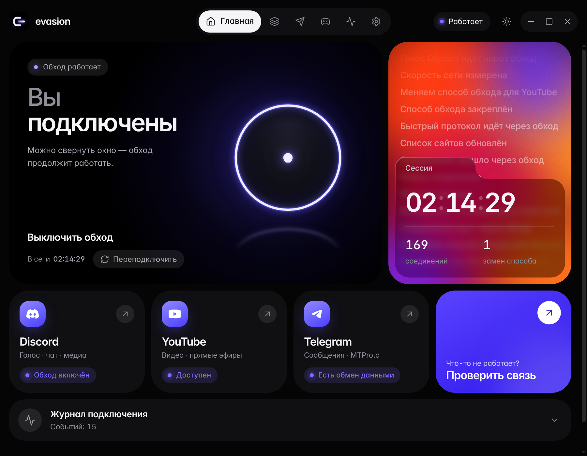
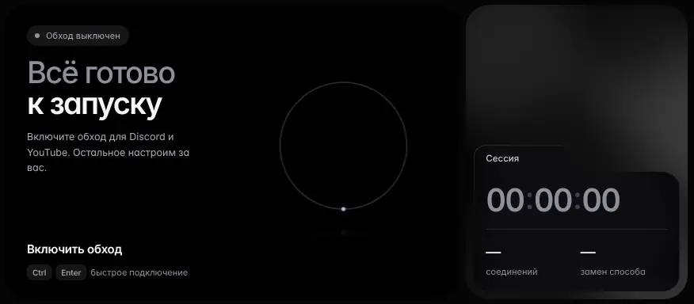
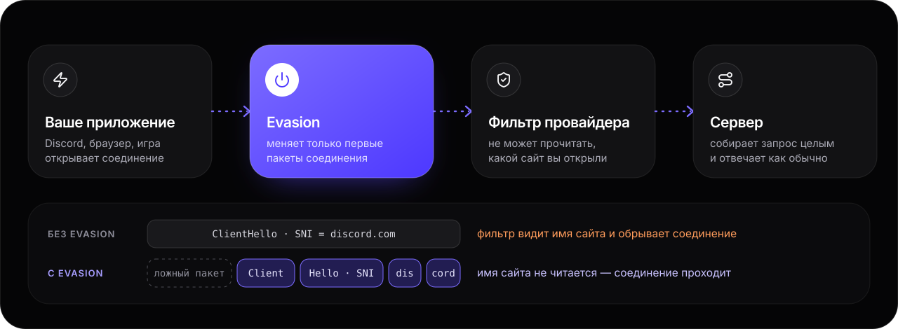
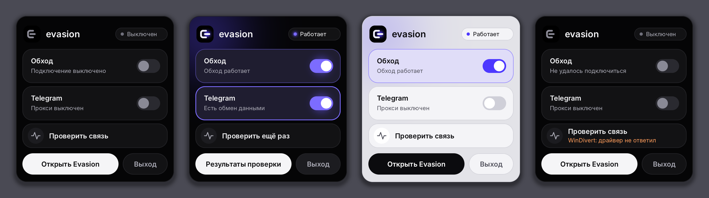

<p align="center">
  
</p>

<p align="center">
  <a href="https://github.com/darkandcryssis-eng/evasion-desktop/releases/latest/download/Evasion.exe">
    
  </a>
</p>

<p align="center">
  <sub>Один файл, установка не нужна · Windows 10 / 11, 64-бит ·
  <a href="https://github.com/darkandcryssis-eng/evasion-desktop/releases/latest">все версии и контрольные суммы</a></sub>
</p>

<p align="center">
  <sub>Evasion сам проверяет новые версии и показывает «Доступно обновление» — ставится по вашему нажатию.</sub>
</p>

<p align="center">
  
</p>

## Что умеет

<table>
  <tr>
    <td width="76" align="center"></td>
    <td width="50%"><b>Discord</b><br>Вход, чат, картинки, голос и демонстрация экрана.</td>
    <td width="76" align="center"></td>
    <td width="50%"><b>YouTube</b><br>Видео и прямые эфиры. Приложение само следит, что ролики открываются.</td>
  </tr>
  <tr>
    <td align="center"></td>
    <td><b>Telegram</b><br>Встроенный прокси включается одной кнопкой. Сообщения остаются зашифрованными.</td>
    <td align="center"></td>
    <td><b>Игры</b><br>Обход только для выбранных игр и только пока они запущены: Albion Online, Ubisoft Connect или любой свой <code>.exe</code>.</td>
  </tr>
  <tr>
    <td align="center"></td>
    <td><b>Без VPN</b><br>Discord и YouTube идут напрямую, ваш IP не меняется. Остальной интернет работает как обычно.</td>
    <td align="center"></td>
    <td><b>Чинит себя сам</b><br>Если способ обхода перестал работать, Evasion проверяет другие и переключается на рабочий.</td>
  </tr>
  <tr>
    <td align="center"></td>
    <td><b>Живёт в трее</b><br>Окно можно свернуть: обход продолжит работать. Есть автозапуск вместе с Windows.</td>
    <td align="center"></td>
    <td><b>Проверка связи</b><br>Если что-то не открывается, диагностика покажет причину и подскажет, что исправить.</td>
  </tr>
</table>

## Как начать

1. **Скачайте** [`Evasion.exe`](https://github.com/darkandcryssis-eng/evasion-desktop/releases/latest/download/Evasion.exe) и положите в любую папку.
2. **Запустите.** Windows попросит права администратора: они нужны драйверу, который работает с сетевыми пакетами.
3. **Нажмите на кольцо.** Через несколько секунд загорится «Вы подключены».

<p align="center">
  
</p>

> [!NOTE]
> Файл пока не подписан сертификатом, поэтому при первом запуске SmartScreen может показать
> «Система Windows защитила ваш компьютер». Нажмите **Подробнее → Выполнить в любом случае**.
> На Windows 10 приложение может предложить установить компонент WebView2 — согласитесь.

## Как это работает

<p align="center">
  
</p>

Провайдер блокирует сайты с помощью DPI — оборудования, которое заглядывает в начало
каждого соединения и ищет там имя сайта. Найдя запрещённое имя, оно обрывает или
замедляет соединение.

Evasion вмешивается ровно в этот момент:

- **Перехватывает только начало соединения.** Через драйвер [WinDivert](https://reqrypt.org/windivert.html)
  приложение получает первые пакеты (TLS ClientHello, первый пакет голосовой сессии Discord)
  и только для сервисов из списка. Весь остальной трафик не трогается.
- **Отправляет их иначе.** Запрос режется на части, меняется порядок частей или перед ним
  уходит ложный пакет, который до сервера не доживает. Фильтр не может собрать из этого
  имя сайта, а сервер по правилам TCP собирает исходный запрос без потерь.
- **Сам выбирает способ.** Провайдеры фильтруют по-разному, поэтому Evasion держит набор
  способов, проверяет их на реальных соединениях и оставляет тот, что работает в вашей сети.
- **Не оставляет следов.** Все изменения в системе записываются в журнал и откатываются
  при выключении.

Аккаунт не нужен, своих серверов у Evasion нет. Шифрование соединений не
затрагивается — меняется только то, как пакеты разложены в сети.

<details>
<summary><b>Подробности для технарей</b></summary>

<br>

- Стратегия — дерево примитивов `fragment`, `tamper`, `duplicate`, `tcp_overlap`
  (представление взято из Geneva, CCS 2019).
- `tcp_overlap` отправляет настоящий ClientHello под прикрытием пакета с безобидным SNI,
  перекрытого по TCP seq: DPI разбирает прикрытие, сервер — оригинал.
- Автопилот (`internal/control`, `internal/scoring`) ведёт портфель стратегий, меряет их
  на живом трафике и пробах, повышает рабочие и опускает деградировавшие.
- QUIC к выбранным сервисам можно блокировать, чтобы браузер ушёл на TCP, где работает обход.
- Десктоп — Wails (Go + React), движок встроен в `Evasion.exe` и запускается подпроцессом.

Дальше: [движок и CLI](docs/ENGINE.md) · [архитектура](docs/ARCHITECTURE.md) ·
[рецепт для Discord](docs/discord-ru.md) · [десктопное приложение](ui/README.md)

</details>

## В трее и в двух темах

<p align="center">
  
</p>

Правый клик по значку у часов открывает панель: включить обход и Telegram, проверить связь,
открыть окно. Тёмная и светлая темы переключаются кнопкой в шапке окна.

## Частые вопросы

**Это VPN?**
Нет. Трафик идёт напрямую к сайту, IP-адрес остаётся вашим, скорость не режется чужим сервером.
Для Telegram используется встроенный локальный прокси; если прямой маршрут закрыт, он
может пойти через резервные узлы сообщества (отключается в параметрах Telegram).

**Нужно ли что-то настраивать?**
Нет. Дополнительные параметры есть, но для большинства сетей менять ничего не нужно.

**Антивирус ругается на WinDivert.**
WinDivert — открытый драйвер для работы с сетевыми пакетами, он лежит внутри `Evasion.exe`.
Некоторые антивирусы помечают его как потенциально нежелательный инструмент; при
необходимости добавьте папку Evasion в исключения.

**Не заработало. Что делать?**
Откройте раздел «Диагностика» и нажмите «Проверить связь»: приложение покажет, что именно
не отвечает. Блокировки у провайдеров разные и меняются, поэтому гарантии для каждой
сети нет.

**Как удалить?**
Выключите обход, выйдите через трей и удалите `Evasion.exe`. Данные приложения лежат
в `%LOCALAPPDATA%\Evasion`.

## Сборка из исходников

Нужны Go 1.27, Node.js и [Wails v2](https://wails.io). На Windows:

```
ui\build-and-run.bat
```

Скрипт собирает движок, кладёт его вместе с WinDivert в `ui\payload` и собирает единый
`Evasion.exe`. Подробности — в [`ui/README.md`](ui/README.md), работа с движком без
окна — в [`docs/ENGINE.md`](docs/ENGINE.md).

## Лицензии

- WinDivert поставляется под LGPLv3 и связывается только динамически.
- Принципы устройства стратегий взяты из академических источников (Geneva, CCS 2019);
  параметры стратегий существующих инструментов не используются.
